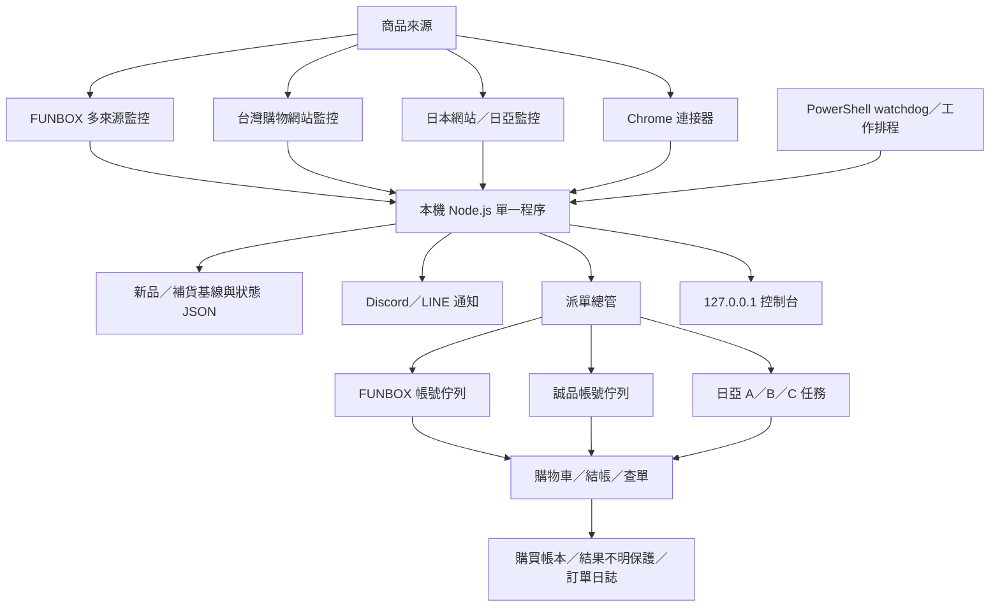
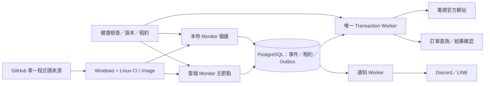

# Phase 1 專案盤點：Linux 移植、Codex Cloud 與雲地備援

盤點日期：2026-10-19（Asia/Taipei）

盤點範圍：`D:\codex\beyblade-watcher`、公開 GitHub Repository `20220604kk/ken-beyblade-watcher`、本機正式服務的唯讀狀態，以及 OpenAI 官方環境文件。

本次只讀取程式、設定結構與服務狀態，另執行不送單的語法／離線回歸測試。未停止或重載服務，未變更帳密、Cookie、購物車、通知、資料庫或自動下單設定，也未建立真實訂單。

## 一、結論

目前系統不是「已可直接搬到 Linux 的雲端成品」，但也不是必須重寫。

- **純 API／HTML 監控核心：約 70% 可直接跨 Linux。** Node.js、`fetch`、HTML／JSON 解析、排程、Discord／LINE 通知與大部分狀態邏輯本身可移植。
- **完整功能等價 Linux 版：約 45% 完成。** Playwright 可跨 Linux，但目前固定使用 Google Chrome、Windows 啟停腳本、WinForms 控制器、Windows 排程及普通 Chrome 擴充同步。
- **可安全雙節點且不重複下單：約 25% 完成。** 現有帳號鎖、購買保留與結果不明保護適用於單一 Node 程序；沒有跨機資料庫租約、事件佇列或唯一交易 Worker。
- **Codex/OpenAI-hosted sandbox 適合開發、測試、Linux 相容驗證，不適合直接充當唯一 24/7 正式主機。** 官方文件說明它是工作階段型 Linux workspace；檔案只在 sandbox 存活期間保留，停止活動與 keep-alive 一小時後 sandbox 可被刪除。若需要自有持久運算，官方建議使用 self-hosted environment，由使用者管理運算與儲存。
- **最務實的第一版是雲端監控、本地下單。** 先把無帳號或低敏感的 API／HTML 監控移到常駐 Linux；保留需要普通 Chrome、人工驗證、Cookie／付款資料的交易 Worker 在本機。等共用事件表與交易租約完成，再評估將部分下單移到遠端持久主機。

以上百分比是依現有程式依賴與缺少的部署元件做的工程估算，不是效能或成交率保證。

## 二、目前版本與正式服務

### GitHub 狀態

- Repository：`https://github.com/20220604kk/ken-beyblade-watcher`
- 2026-10-19 查驗時為 **Public**，沒有 LICENSE。
- GitHub `main` 最新提交：`61b7a79fe2c4e16d6c9c55dff2801e8a8db86f88`，共 3 次提交、101 個檔案。
- 本機 `HEAD`：`bce3a2625d6281490b67dbceaaad3e4b2f87090e`，本機追蹤的 `origin/main` 尚停在初始提交。
- 本機正式工作樹有 49 個已追蹤檔案變更及大量未追蹤的新模組、測試與文件；最新日亞 HTTP、登入範圍隔離、Linux 前置工具等多數只存在本機。
- 結論：**GitHub 目前不是正式服務的完整可重建來源，直接從 GitHub 部署會退回舊功能。** 第一個遷移工作不是 Docker，而是先保存、審核並版本化本機現況。

### 本機正式服務快照

- Node.js `v24.15.0`，npm `11.12.1`。
- 控制台：`127.0.0.1:3210`，服務 PID 由 `data/monitor-service.pid` 管理。
- Windows PowerShell watchdog 正在執行；「戰鬥陀螺監控自動復原」排程存在，每 5 分鐘檢查服務。
- FUNBOX、購物網站、日本網站、日亞監控與 FUNBOX／誠品自動下單總開關均有啟用模組。
- 唯讀快照當下：自動下單未處理、佇列 0；FUNBOX 3 個帳號欄位、誠品 5 個帳號欄位；日亞 A 啟用，B／C 停用。
- 完整離線回歸：`1059 passed / 0 failed`；`npm run check` 通過。

測試通過證明本機邏輯一致，不代表官網端點、登入、庫存、付款或下次補貨成交已通過。

## 三、現有系統架構

目前是**單體程序加本機檔案**：

- 主入口 `src/index.js` 約 4,238 行，負責組裝監控、排程、控制台、通知與下單。
- `src/auto-purchase.js` 約 7,104 行，包含 FUNBOX／誠品登入、帳號協調、購物車、結帳、重試與查單。
- `src/shopping-sites.js` 約 3,729 行，包含多平台來源解析、誠品 API 探索及基線。
- 控制台 `src/dashboard.js` 約 1,844 行，綁定本機 Host 與操作 API。
- 沒有 PostgreSQL、pgvector、Redis、SQLite、Queue client、Docker、systemd 或 GitHub Actions。

## 四、功能與監控網站清單

### 目前正式設定有啟用

| 類別 | 來源 | 路徑／方式 | 自動下單 |
|---|---|---|---|
| FUNBOX | FUNBOX 官網 | 分類頁、集合產品、搜尋 JSON API、商品規格補讀，多來源合併 | 有，FUNBOX 專用 API／瀏覽器備援流程 |
| 購物網站 | momo FUNBOX 品牌專區 | 分類／商品 API | 無 |
| 購物網站 | momo 墊腳石專區與搜尋 | 店舖 API／分類頁 | 無 |
| 購物網站 | 誠品線上 | Holmes 搜尋 API、策展、`purchase_status`、商品基線 | 有，誠品多帳號 API 流程 |
| 購物網站 | 墊腳石官網 | 商品 API | 無 |
| 日本網站 | 1999.co.jp | 清單解析 | 無 |
| 日本網站 | 樂天 Books | HTTP／HTML | 無 |
| 日本網站 | Taiyo Market | HTTP 優先、瀏覽器備援 | 無 |
| 日本網站 | 日本樂天全市場 | HTTP 優先、瀏覽器備援 | 無 |
| 日本網站 | 樂天單品 CX-20 | 單品直查 | 無 |
| 日本網站 | OCN 官網 | 搜尋與商品頁核對 | 無 |
| 日本網站 | 愛電王 EDION | Chrome 擴充橋接 | 無 |
| 日亞監控 | Amazon.co.jp | 定價表、品牌／搜尋 ASIN、商品報價／賣家核對 | 另有 A／B／C 指定商品下單 |

### 已支援但目前停用

- momo 戰鬥陀螺限量發售。
- 森森文具 Cyberbiz collection。
- 童無忌 Cyberbiz collection。
- MM 小舖。
- 優彩棠 1／2 號店、OCN 樂天、EDION 一般搜尋。
- 蝦皮 Chrome 連接器程式仍存在，是否安裝、配對與運作需在瀏覽器端另驗證。

### 已有程式但正式設定缺失

- `src/japan-stores.js` 已有 **Nojima Online** 與 **玩具反斗城.jp** 解析器。
- `config.json` 的 `additionalStoresSeeded` 已是 `true`，實際 target 清單卻沒有這兩個來源。
- 因程式只在旗標不是 `true` 時補建來源，現行服務不會自動修復缺項。
- 狀態：**已確認設定遷移缺口；本次未修改。**

### 已退役

- Facebook 粉專、熱點與 Google 表單正式能力已封存為 `1010FB暫存`。
- 正式程式保留 `facebook-retired.js` 拒絕舊入口，但不執行 FB 掃描或填表。

## 五、自動下單實際能力

### 共用派單

- 黑名單排除、白名單資格、優先關鍵字排序、帳號購買規則與配送相容性。
- 每帳號獨立佇列；同帳號序列化，不同帳號有限並行。
- 單品一單及多款合單。
- 購買帳本、日額度／永久限購、本地額度保留、正式單號去重。
- `submitted_unconfirmed` 結果不明保護：不清車、不直接重送，先查正式訂單。

### FUNBOX

- 多帳號、API session、API 購物車與結帳契約。
- ATM、7-11 取貨付款；官方未提供指定方案時可依設定使用宅配 LINE Pay 待付款備援。
- 強制紅利 0、含運上限、門市／配送資料核對。
- 明確拒單才有限重試；逾時或不明改為唯讀查單。
- 正式訂單品項、數量、付款、金額與單號核對後才宣告成立。

### 誠品

- A～E 多帳號、API session、Holmes／會員／購物車／checkout／查單流程。
- 宅配 ATM、7-11 取貨付款；門市資料不可用時可檢查共用宅配 ATM 備援。
- 強制 `discount_point = 0`，配送、付款、收件資料及含運上限核對。
- 單品與合單，明確忙碌拒單才有限重試；回應不明保護帳號。
- LINE Pay 正式一次性付款憑證串接仍未完成，不應宣稱完整可用。

### 日亞 A／B／C

- API 報價／直接購買主線，瀏覽器保留登入及人工驗證。
- 官方賣家、全新、價格、運費上限、數量 1、正式訂單編號核對。
- 每帳號交易鎖、結果不明查單、不可盲目重送。
- 曾設計 API＋普通 Chrome 擴充雙路競速；個人插件目前已由使用者移除，正式狀態為未連線。
- A 目前啟用，B／C 停用。

## 六、資料、憑證與外部服務

### 本機持久資料

- `data/state.json`：商品基線、監控狀態、購買帳本、任務與結果保護；原子暫存寫入、最多每分鐘保留 `state.json.last-good`。
- `data/private-purchase/credentials.enc.json`：AES-256-GCM 加密的帳密、收件與結帳資料。
- `data/private-purchase/.credential-key`：本機 32-byte 解密金鑰。金鑰和密文目前放在同一主機，只能防止誤讀／誤上傳，不能防止主機被取得。
- Playwright storage state、登入 session、瀏覽器 persistent profile、診斷快照、永久訂單紀錄與日誌均在 `data/`／`records/`／`logs/`。
- 目前 `data/` 約 **6.55 GB、57,708 個檔案**；主要是多組 Chrome／Playwright profiles。`logs/` 約 60.6 MB。

### 外部服務

- Discord：公開、私人、MM 小舖、日本等 Webhook 分流；另有 Bot Token／狀態頻道自動更新。
- LINE：Messaging API Push 通知。
- Google Sheets：商品售價／名單資料來源，可選設定。
- 電商官方 API／HTML：FUNBOX、誠品、momo、墊腳石、各日本網站與 Amazon.co.jp。
- Chrome MV3 連接器：愛電王、蝦皮、誠品 session 同步；日亞競速連接器程式存在但目前未安裝連線。

### 安全盤點

- `.gitignore` 已排除 `.env`、`config.json`、`data/`、`records/`、`logs/`、`artifacts/`、Cookie／storage state／credentials 等常見私密資料。
- 本機已追蹤檔案的模式掃描未找到 Discord Webhook 格式；電話／訂單／密碼模式集中於測試或沙盒假資料。
- 這不是完整 secret-history audit；公開前仍應對 GitHub 三次提交與即將提交的本機全部檔案跑正式 secret scanner。
- GitHub 頁面文字仍稱「維持私人」，實際 Repository 已是 Public，文件與實際狀態矛盾。

## 七、Linux 相容性

| 項目 | 判定 | 問題／修改 |
|---|---|---|
| Node.js ESM、fetch、Cheerio、iconv | 可直接移植 | Node 20+；建立 Linux CI 即可驗證 |
| Discord／LINE HTTP 通知 | 可直接移植 | 改用 secret manager 注入 |
| JSON 狀態、AES-GCM 帳密 | 可執行但須調整 | 資料目錄外置、備份、金鑰獨立保存、單寫入者 |
| Playwright headless | 部分可移植 | 目前多處 `channel: 'chrome'`；Docker 需安裝 Google Chrome，或改成可設定 Chromium channel |
| Persistent Chrome profiles | 不可直接搬 | 不建議跨 Windows／Linux複製完整 Profile；應重新登入或只移轉受控 storage state |
| 普通 Chrome 擴充連接器 | 不可直接取代 | 綁本機 Chrome 與 `127.0.0.1:3210`；遠端需專用桌面瀏覽器或保留本地 connector worker |
| 人工 CAPTCHA／登入驗證 | 不可自動移除 | 需安全的遠端互動入口；不得繞過 |
| 控制台 | Linux 可跑但不能遠端直接用 | 只 listen `127.0.0.1`，Host 限本機；需認證反向代理／VPN，不能直接改成 `0.0.0.0` 暴露 |
| 啟停／守護 | Windows 專屬 | `.bat`、PowerShell、VBScript、Scheduled Task、WMI、Win32 PID；改為 systemd／Docker healthcheck |
| 桌面控制器 | Windows 專屬 | C# WinForms、WMI、WebView2；Linux 不搬，改用 Web 管理面或獨立平台殼 |
| 安全關機 | 核心有、目前入口未善用 | Node 支援 SIGINT／SIGTERM 清理；Windows stop 腳本使用 Force kill，需改成先發 SIGTERM／管理 API，再限時強制終止 |
| 時區 | 大致可移植 | 重要帳本／日誌明確使用 `Asia/Taipei`；容器仍應設定 `TZ=Asia/Taipei` 並補 Linux 測試 |
| 檔案大小／磁碟 | 需處理 | 6.55 GB profiles 不應進 image；掛 persistent volume，訂單／狀態另備份 |

### 缺少的 Linux 發佈元件

- Dockerfile／Compose 或其他可重現 image。
- `.dockerignore` 與非 root 執行者。
- Playwright／Chrome system dependencies。
- systemd unit 或容器 healthcheck／restart policy。
- Linux 路徑與檔案權限測試。
- GitHub Actions：Windows + Linux 語法／單元／整合測試。
- 設定 schema 驗證與 migration runner。
- 遠端健康端點與有認證的管理入口。
- 版本標記、image tag、部署紀錄及一鍵回滾。

## 八、服務管理成熟度

| 能力 | 現況 |
|---|---|
| 健康檢查 | 有 `/api/status`，Windows 啟動腳本確認主要欄位；沒有獨立 liveness／readiness 契約 |
| 自動重啟 | 有 Windows watchdog 與 5 分鐘 Scheduled Task |
| 結構化日誌 | 部分 JSON 狀態／訂單紀錄；主要運行日誌仍是純文字 |
| 日誌保留 | 有 6 小時背景維護、分類與封存；仍須雲端集中／大小政策 |
| 異常通知 | 平台與部分任務有通知；程序死亡、磁碟、狀態保存失敗尚未形成完整告警鏈 |
| 統一設定 | 部分；分散在 `.env`、`config.json`、`state.json`、加密帳密、瀏覽器 profiles |
| 安全關機 | Node 核心支援；Windows 日常 stop 是 Force kill，流程不一致 |
| 未完成任務恢復 | FUNBOX／誠品／日亞有結果不明與購買保留；跨節點尚無租約或共享 durable intent |
| 狀態損壞恢復 | 有 preflight、last-good、明確 recovery 工具；不會默默清空購買歷史 |
| 版本回滾 | 尚未建立；GitHub 也不含當前正式版本 |

## 九、Codex Cloud／OpenAI-hosted 環境可行性

依 2026-10-19 查閱的 OpenAI 官方文件：

- OpenAI-hosted sandbox 提供 Linux workspace、Python、Node.js 與命令列工具。
- 可安裝 packages、執行 setup commands、設定網路與環境變數；密鑰建議使用 vault credentials。
- 工作目錄檔案在 sandbox 存活期間跨 turn 保留；`/workspace/outputs` 可產出不可變下載成品。
- 若活動與 keep-alive 停止一小時，sandbox 可被刪除，而且 timeout 不可設定。
- self-hosted environment 的運算、儲存、啟停與復原由使用者自己的 provider 管理；重用 environment ID 不會自動恢復替代主機的檔案。

因此：

| 用途 | 適合度 | 結論 |
|---|---|---|
| 程式修改、測試、Linux CI | 高 | 適合 |
| 建 Docker、跑 dry-run、產報告 | 高 | 適合 |
| 短期瀏覽器／端點驗證 | 中高 | 適合，但登入與網站批准仍需設計 |
| 24／7 高頻監控唯一主機 | 低 | 沒有永久常駐與持久檔案保證，不應使用 |
| 正式帳密／Cookie 唯一保存 | 低 | 不應只存在 sandbox；需 vault／外部 secrets 與持久儲存 |
| 手機查看正式監控狀態 | 低 | Codex 任務介面不是本系統管理台，仍需自建安全 dashboard |
| SSH／遠端桌面 | 尚未驗證 | 查到的官方文件提供 session／environment／computer-use，不代表提供一般 VPS SSH／RDP；不可自行假定 |

OpenAI 官方參考：

- https://developers.openai.com/api/docs/guides/agents-api/environments/openai-hosted
- https://developers.openai.com/api/docs/guides/agents-api/environments/lifecycle
- https://developers.openai.com/api/docs/guides/agents-api/environments/security

## 十、雲地備援架構

### 建議角色

### 必要資料表／狀態

- `monitor_events`：平台、商品 canonical ID、事件類型、來源時間、payload hash、唯一事件鍵。
- `dispatch_jobs`：篩選後派單、優先級、帳號、狀態與重試時間。
- `purchase_intents`：送單前 durable intent、商品快照、金額上限、狀態、官方單號。
- `account_leases`：`platform + account_identity` 唯一租約、owner、期限、heartbeat、fencing token。
- `notification_outbox`：事件與通知的原子 outbox，避免服務重啟後漏發／重發。
- `node_heartbeats`：節點版本、角色、最近心跳、健康與延遲。

### 不重複交易原則

1. 監控事件可雙節點重複產生，但由唯一事件鍵去重。
2. 下單前必須取得「平台＋帳號」租約與 fencing token。
3. 送單意圖必須先寫入共用資料庫，再呼叫官方端點。
4. 任何 timeout／process crash 都先把 intent 保持為 `submitted_unconfirmed`。
5. 新節點接手前，先查官方訂單；不能只因舊租約過期就直接重送。
6. 同一帳號同時只有一個 Transaction Worker；監控可 active-active，下單不可對同帳號 active-active。
7. Session／Cookie 不放共用明文資料庫；按帳號綁定 Worker 與 secret store，必要時人工重新登入。

## 十一、分階段遷移計畫

### Phase 1A：先取得可重建版本

- 停止把現在 GitHub 當完整來源。
- 對本機現行程式做安全快照與 secret scan。
- 在不碰正式目錄的獨立 worktree 建 migration branch。
- 將 1,059 項測試、目前 docs 與必要模組納入版本控制。
- 處理 GitHub 遠端 2 個本機尚未取得的提交，再做有意義的 merge／rebase；禁止直接覆蓋本機工作樹。
- 決定 Public／Private 與 LICENSE；目前兩者文件互相矛盾。

### Phase 2：可重現 Linux 監控副本

- 拆出跨平台 `core` 與 Windows-only `desktop-control`。
- 新增 Dockerfile、Compose、非 root 使用者、persistent volume、healthcheck。
- Browser channel 與 data path 可設定。
- 新增 GitHub Actions：Node 20／24，Windows／Ubuntu，完整離線測試。
- 先只啟用 HTTP/API 監控與 dry-run 通知，所有真實購買關閉。

### Phase 3：共用事件與狀態

- 使用 PostgreSQL，不需要 pgvector。
- 將事件、派單、交易 intent、租約、通知 outbox、節點 heartbeat 放進 DB。
- `state.json` 仍可暫留本機快取，但不再是雙節點唯一真相。
- 先搬監控狀態，再搬購買帳本；每次 migration 都要可回滾。

### Phase 4：雲端 dry-run 對照

- 雲端與本地同時監控，但雲端只寫事件／不發重複通知／不下單。
- 連續觀察 1、6、24、72 小時。
- 比較發現時間、成功率、HTTP latency、Cloudflare／風控、記憶體、磁碟、程序存活。
- 使用獨立外部 health check，不以節點自報為唯一證據。

### Phase 5：通知與監控切主

- 雲端 Monitor 成為主節點，本地 Monitor 為備援。
- 通知由 outbox 唯一 Worker 發送，避免雙貼。
- 愛電王／蝦皮普通 Chrome connector 仍可留本機，將觀測事件安全送到共用 API。

### Phase 6：受控交易 Worker

- 初期 FUNBOX／誠品／日亞交易 Worker 保留本地，雲端只派單。
- 建立帳號租約、fencing token、durable intent 與正式查單後，再做一個帳號／一個平台的小規模雲端 dry-run。
- 真實送單開關預設關閉；啟用前重新取得使用者明確同意。
- 72 小時穩定後才決定主備切換，保留本地復原。

## 十二、預估修改範圍與資源

### 程式修改範圍

| 工作 | 規模 |
|---|---|
| 保存本機現況、整理 Git、secret scan | 中 |
| Docker／Linux 啟停、healthcheck、路徑與 Chrome 設定 | 中 |
| GitHub Actions 跨平台測試 | 小到中 |
| 拆解 4,238 行 `index.js` 與 7,104 行 `auto-purchase.js` 的運行邊界 | 大 |
| PostgreSQL 事件／租約／Outbox schema 與 migration | 大 |
| 雙節點派單去重與 Transaction Worker | 大且高風險 |
| 遠端安全管理台、VPN／反向代理、角色權限 | 中 |
| Session／Cookie／secret migration | 大且高風險 |
| 72 小時 dry-run 與真實平台逐項驗收 | 時間型工作 |

### 建議資源

- **監控-only Linux 節點：** 約 1～2 vCPU、2 GB RAM、10～20 GB persistent disk 可作起點，再以實測調整。
- **完整多瀏覽器節點：** 建議至少 2 vCPU、4 GB RAM、20～40 GB persistent disk；目前本機 profiles 已約 6.55 GB，若全部搬入需更多空間與備份。
- **PostgreSQL：** 小型持久實例即可起步；不需要 pgvector。
- **管理通道：** Tailscale／WireGuard 或具 MFA 的反向代理；不直接公開目前的 `127.0.0.1` 控制 API。
- **備份：** 狀態／購買帳本、DB、加密 credentials 與解密 key 分開備份；瀏覽器 profiles 採選擇性備份或重新登入策略。

資源數字是起始估算；尚未在 Linux 上量測實際 Chrome memory、I/O 與網站延遲。

## 十三、低成本方案排序

### 方案 A：現有 Windows 主交易＋低成本 Linux 監控（建議）

- 雲端負責 FUNBOX／momo／誠品探索／日本 HTTP 來源及通知事件。
- 本機只保留 connector、登入維護及唯一交易 Worker。
- 優點：最快降低本機常態瀏覽器負擔，交易風險最低。
- 缺點：本機仍須在搶購時可用。

### 方案 B：小型常駐 Linux VPS 完整監控＋本地備援

- VPS 跑 Docker monitor、PostgreSQL 或外部 managed DB。
- 本地保留相同 image、但平時 standby。
- 優點：真正 24／7、可控磁碟與程序。
- 缺點：需要月費、伺服器更新、遠端登入及 secret 管理。

### 方案 C：Vercel／Firebase 只做管理 API 或事件入口

- 不把現有長時間 while／timer／Playwright 程序直接塞入 serverless。
- 可用於 dashboard API、webhook、通知 outbox 或健康頁面。
- 若要承擔高頻監控，必須重構成外部 scheduler／queue／短任務，並評估平台時間與流量限制。

### 不採用

- 把 Codex 任務、AI heartbeat、無限循環或定期模型呼叫當免費 VPS。
- 雲端與本地同時對同一帳號 active-active 送單。
- 直接把 3210 控制台改成 `0.0.0.0` 公開。
- 將 Cookie、帳密、Token、`data/` 或完整 Chrome Profile 推到 GitHub。

## 十四、立即優先事項

1. **保存並版本化本機正式程式。** 這是目前最大的單點故障。
2. **修正 GitHub Public／README「私人」矛盾，做完整提交歷史 secret scan。**
3. **建立 Windows＋Linux CI 與 Docker dry-run，保持所有購買預設關閉。**
4. **修正 Nojima／玩具反斗城 seed 旗標缺項。**
5. **設計 PostgreSQL 事件鍵、交易 intent、account lease 與 notification outbox。**
6. **先搬純監控，不先搬登入／付款。**
7. **完成 72 小時外部健康觀測後，才決定雲端主／備角色。**

## 十五、尚未驗證

- Codex／Agents API 功能是否已對此帳號開放、實際 API 成本與配額。
- 先前提到的 Codex Cloud VM 是否仍是同一產品形態、是否能由此帳號建立長期環境。
- OpenCode 所謂 DeepSeek 免費模型目前的名稱、免費額度、限速及期限。
- 任一 Linux 主機對 FUNBOX、誠品、Amazon.co.jp 與日本網站的實際 IP 風控。
- Google Chrome／Playwright 在目標 Linux 主機的記憶體與穩定性。
- Windows Chrome Profile 搬到 Linux 是否可登入；目前不建議直接搬。
- LINE Pay 的正式一次性付款契約。
- Nojima／玩具反斗城正式 target 缺失是否為人工刪除；程式目前無法自動補回。
- GitHub 最新 2 個遠端提交與本機大量變更的逐檔合併結果。

## 驗證紀錄

- `npm run check`：通過。
- `node --test --test-concurrency=1`：1059 通過、0 失敗、0 略過。
- 本機 `/api/status`：HTTP 正常，正式服務未重載。
- GitHub API／Repository 頁面：Public、3 commits、遠端 main SHA 已核對。
- 未執行官網購買、通知測試或外部登入。
